<div align="center">

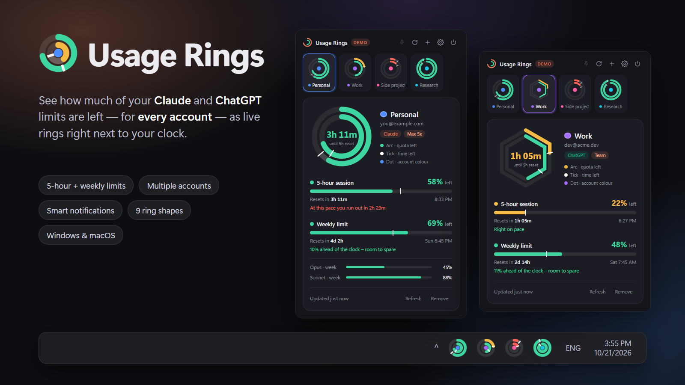

# Usage Rings

**Know how much Claude and ChatGPT you have left — before you hit the wall.**<br/>
One tiny two-ring icon per account, right next to your clock. Hover for details. Click for the full picture.

[](https://github.com/rusavladev/claude-usage-rings/actions/workflows/ci.yml)
[](https://github.com/rusavladev/claude-usage-rings/releases)
[](LICENSE)


[**Download**](#-install) · [**How to use it**](#-using-usage-rings) · [**Reading the rings**](#-reading-the-rings) · [**Notifications**](#-notifications) · [**FAQ**](#-faq--troubleshooting)

</div>

---

## Why?

Claude and ChatGPT (Codex) both give you **two limits at once**: a short **5-hour session** and a longer **weekly** allowance. Running out in the middle of a task is annoying — and checking the usage page over and over is worse.

**Usage Rings** puts both limits in your system tray / menu bar as a small pair of concentric rings, one icon per account:

- 🟢 **outer ring** = your 5-hour session · **inner ring** = your weekly limit
- the coloured arc is **how much is left** — it drains as you work, and turns green → amber → red
- a brighter track plus a tiny white tick show **how much of the window's time is left**, so you can tell at a glance if you're burning through quota faster than the clock
- run as many accounts as you like (personal, work, side project, Claude *and* ChatGPT) — each gets its own icon, colour, shape and notification rules

No browser tabs, no dashboards. Just glance down.

## ✨ Features

| | |
|---|---|
| 🎯 **Two rings per account** | 5-hour session (outer) and weekly limit (inner), plus per-model weekly limits such as *Opus*, *Sonnet* or *Fable* when your plan has them. |
| 👥 **Unlimited accounts** | Sign in to as many **Claude** and **ChatGPT** accounts as you want. Each one is a separate tray icon. |
| ⏱️ **Time-aware** | Every ring shows what's left *and* how much of the window remains, with live countdowns and a **pace hint** ("at this pace you run out in 2h 29m"). |
| 🪟 **Hover card** | Hover an icon to get a card with progress bars, reset times and per-model limits — no click needed. |
| 🔔 **Smart notifications** | Threshold alerts (50/75/90/95/100 %), heavy-usage bursts ("10 % in 10 minutes"), "you'll run out early", window resets, sign-in problems. Configured **per profile**. |
| 🎨 **Make it yours** | 9 ring shapes (circle, squircle, square, diamond, triangle, pentagon, hexagon, octagon, star), an identity colour per account, rename profiles freely. |
| 🔐 **Private by design** | Tokens are encrypted with your OS (Windows DPAPI / macOS Keychain). Nothing leaves your machine except calls to Anthropic / OpenAI. No telemetry. |
| 🚀 **Set and forget** | Starts quietly at login, remembers your sign-ins, refreshes every 5 minutes (configurable), recovers from sleep and network drops. |

## 🖼️ Screenshots

<table>
  <tr>
    <td width="50%" align="center">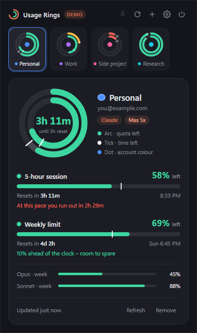<br/><sub><b>The detail popup</b> – both limits, reset times, pace hint, per-model limits.</sub></td>
    <td width="50%" align="center">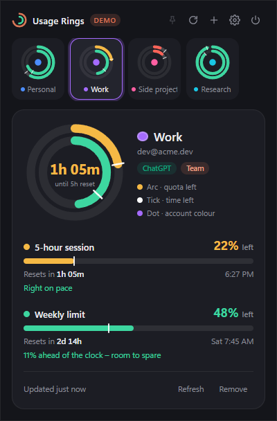<br/><sub><b>ChatGPT accounts</b> work the same way (Codex 5-hour + weekly limits).</sub></td>
  </tr>
  <tr>
    <td align="center">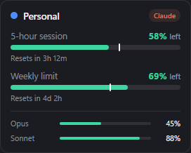<br/><sub><b>Hover card</b> – shows up when you point at a tray icon.</sub></td>
    <td align="center"><br/><sub><b>The tray icons</b> – one per account, each with its own colour dot.</sub></td>
  </tr>
  <tr>
    <td align="center">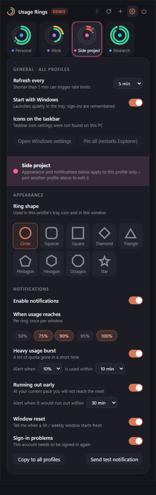<br/><sub><b>Settings</b> – refresh rate, ring shape and notification rules, per profile.</sub></td>
    <td align="center"><br/><sub><b>9 ring shapes</b> – because why not.</sub><br/><br/>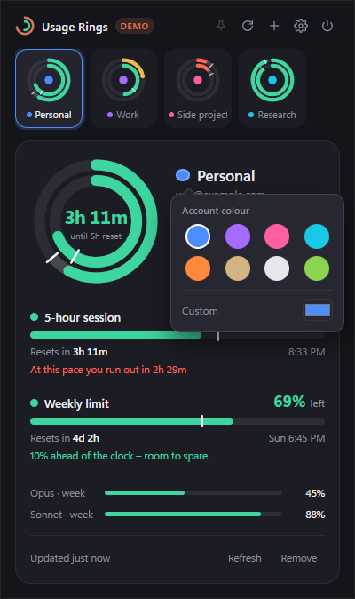<br/><sub>Pick an account colour or rename a profile.</sub></td>
  </tr>
</table>

> The screenshots use **demo data** (`npm run demo`) — no real accounts.

### 🍎 On macOS

Captured by the CI smoke test on a real **macOS** runner — same app, native system font, no Windows-only controls:

<p align="center">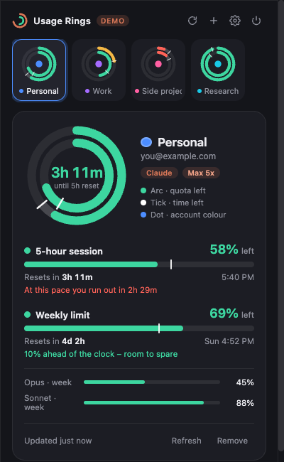&nbsp;&nbsp;&nbsp;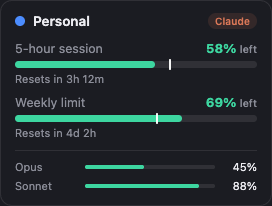</p>

## 📥 Install

### Option A — download a build (easiest)

Grab the latest zip from the **[Releases page](https://github.com/rusavladev/claude-usage-rings/releases/latest)**:

| Your computer | Download |
|---|---|
| Windows 10 / 11 (64-bit) | `UsageRings-windows-x64.zip` |
| Mac with Apple Silicon (M1 / M2 / M3 / M4) | `UsageRings-macos-arm64.zip` |
| Mac with an Intel chip | `UsageRings-macos-x64.zip` |

<details open>
<summary><b>🪟 Windows</b></summary>

1. Unzip the download anywhere you like (for example `C:\Apps\Usage Rings`).
2. Double-click **`Usage Rings.exe`**.
3. Windows SmartScreen may say *"Windows protected your PC"* because the app is not code-signed: click **More info → Run anyway**.
4. Look for the new ring icon(s) by your clock. Windows hides new tray icons behind the **`^`** arrow — to keep them visible, open the app and use the yellow banner's **Pin all** button (or switch them on in *Settings → Personalization → Taskbar → Other system tray icons*).
5. Click the icon → **＋** → add your first account (see [Using Usage Rings](#-using-usage-rings)).

The app creates a *Usage Rings* Start-menu entry and starts with Windows (turn that off in Settings).
</details>

<details open>
<summary><b>🍎 macOS</b></summary>

1. Unzip, then drag **`Usage Rings.app`** into your **Applications** folder.
2. The first time, **right-click → Open** (then *Open* again). The app is ad-hoc signed but not notarised by Apple, so a plain double-click is blocked by Gatekeeper. If macOS says the app is *damaged*, run this once in Terminal and try again:
   ```bash
   xattr -dr com.apple.quarantine "/Applications/Usage Rings.app"
   ```
3. The rings appear in the **menu bar** (top right). There is no Dock icon.
4. macOS will ask to use the *"Usage Rings Safe Storage"* Keychain item — choose **Always Allow**. It's where your sign-in tokens are kept (encrypted).
5. Click a ring → **＋** to add your first account.

> **macOS status:** every push is smoke-tested by GitHub Actions on real macOS runners (4 tray icons, popup and hover card all come up and render — see the screenshots above), and release builds are smoke-tested the same way. The author develops on Windows, so if something looks off on your Mac, please [open an issue](https://github.com/rusavladev/claude-usage-rings/issues) — screenshots welcome.
</details>

### Option B — run from source

Requirements: **Node.js 20+** (22 recommended) and **git**.

```bash
git clone https://github.com/rusavladev/claude-usage-rings.git
cd claude-usage-rings
npm install
npm start
```

Try it without signing in to anything — fake accounts, no network:

```bash
npm run demo
```

Build your own standalone app (written to `dist/`):

```bash
npm run pack                                   # for the OS you're on
npm run pack -- --platform=darwin --arch=arm64 # (run on a Mac) – ad-hoc signed automatically
```

## 🚀 Using Usage Rings

### 1. Add your accounts

Click a tray icon (or the empty placeholder icon) to open the popup, then press **＋**.

<p align="center">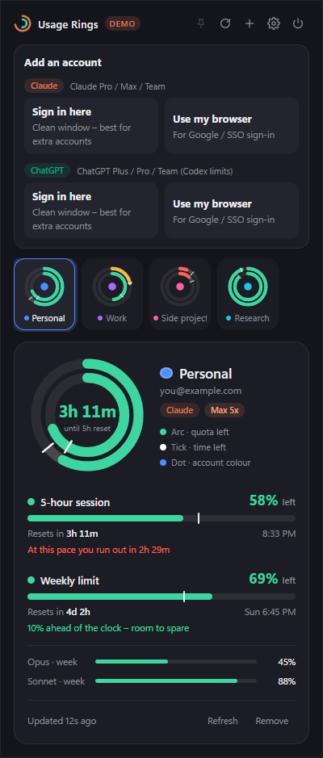</p>

- Pick **Claude** or **ChatGPT**.
- **Sign in here** opens a *clean* sign-in window every time — perfect for adding a **second or third account** without logging out of anything.
- **Use my browser** opens your default browser instead — handy for Google / SSO sign-ins (use a private window to pick a different account).
- Approve access. The window says *Account connected* and closes; your new icon appears.

Repeat for every account. Re-adding an account that already exists simply refreshes its sign-in.

### 2. Glance, hover, click

| Action | What you get |
|---|---|
| **Glance** at the tray | Arc length and colour of both rings, tick for time left, your account colour in the middle. |
| **Hover** an icon | A card with both bars, "resets in …", and per-model weekly limits. |
| **Click** an icon | The detail popup for that account: big ring with live countdown, reset times, pace hints. |
| **Right-click** an icon | Show details · Refresh all · Add account · Start at login · Quit. |

### 3. Make each profile yours

Open **⚙ Settings**. Everything below the profile bar applies to the **selected profile only** (switch profiles with the strip at the top, or use *Copy to all profiles*):

- **Ring shape** — circle, squircle, square, diamond, triangle, pentagon, hexagon, octagon, star.
- **Notifications** — see below.
- Click the **name** (or the pencil) in the detail card to **rename** a profile, and the **coloured dot** to change its colour.

Global options: **refresh interval** (1 – 60 min, default 5), **start at login**, and (Windows) the taskbar pinning helper.

## 🔭 Reading the rings

<p align="center">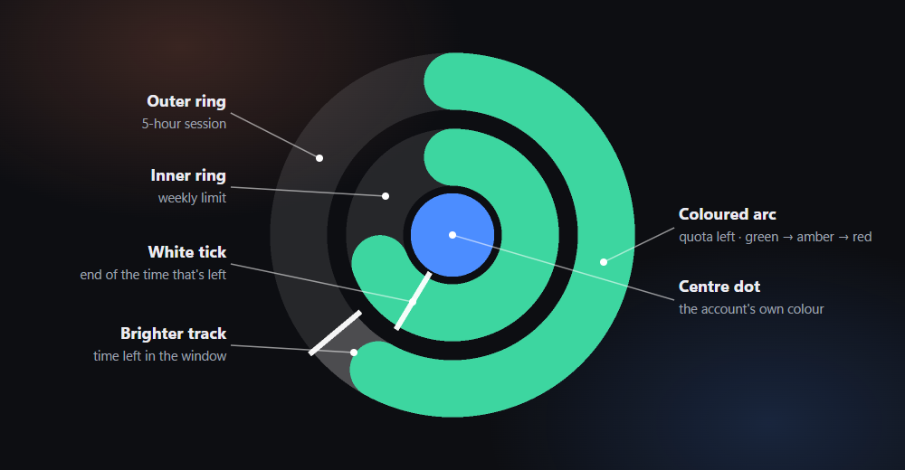</p>

| Part | Meaning |
|---|---|
| **Coloured arc** | How much of the limit is **left**. It drains as you use it. |
| **Colour** | 🟢 plenty left · 🟠 getting low (≥ 60 % used) · 🔴 almost out (≥ 85 % used) |
| **Brighter track** | How much of the window's **time** is left. |
| **White tick** | End of the time that's left. **Keep the coloured arc ahead of the tick** and you'll make it to the reset. |
| **Centre dot** | The account's identity colour. |

In the popup you also get a plain-English **pace hint**, e.g. *"At this pace you run out in 2h 29m"* (red), *"10 % ahead of the clock – room to spare"* (green) or *"Limit reached – resets in 2d 22h"*.

## 🔔 Notifications

Each profile has its own switches (Settings → profile → Notifications):

| Alert | When it fires |
|---|---|
| **Usage reached** | A ring crosses one of your chosen levels — **50 / 75 / 90 / 95 / 100 %** used. Once per window; nothing fires for levels already passed when the app starts. |
| **Heavy usage burst** | A lot of quota disappears quickly — e.g. **10 % within 10 minutes** (both numbers adjustable). |
| **Running out early** | At your current burn rate you'll hit the limit within 15–120 minutes *and* before the reset. |
| **Window reset** | A 5-hour or weekly window starts fresh. |
| **Sign-in problems** | An account needs to be signed in again. |

Use **Send test notification** to check that your OS shows them. Clicking a notification opens that account's popup.

## 🧠 How it works

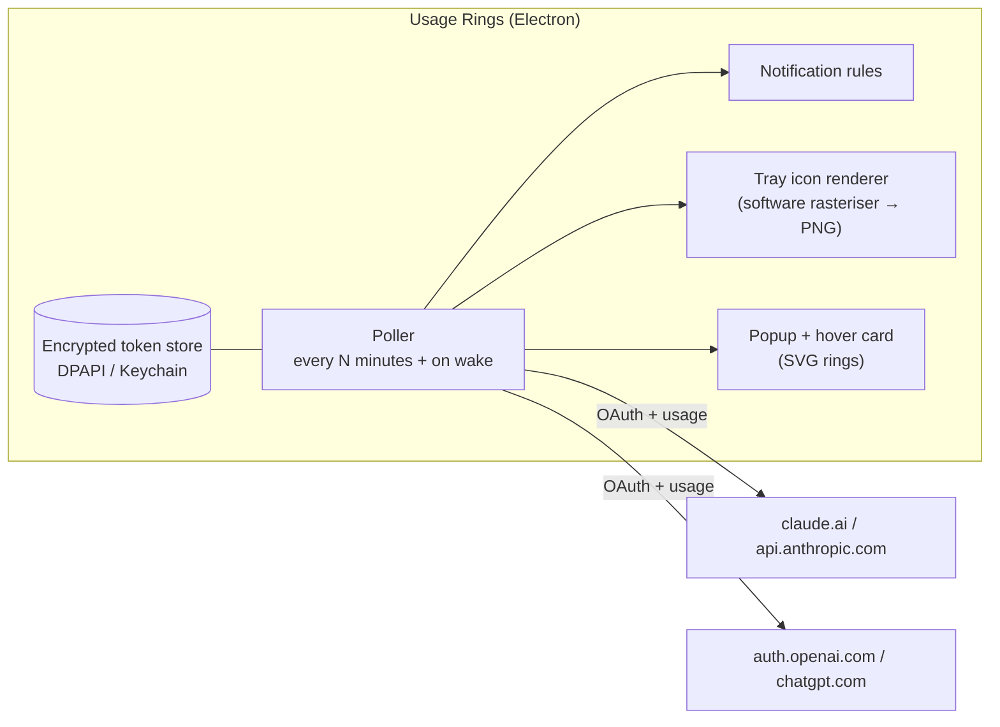

- **Sign-in** is a standard *OAuth 2.0 + PKCE* flow with a loopback redirect — the same public client the official **Claude Code** and **Codex** CLIs use. For Claude only the read-only `user:profile` scope is requested. Each sign-in runs in a throw-away in-memory browser session, so accounts never mix.
- **Usage** comes from the same endpoints those CLIs use for their `/usage` / `/status` views (`api.anthropic.com/api/oauth/usage` and `chatgpt.com/backend-api/wham/usage`).
- **Tray icons** are drawn by a small dependency-free software rasteriser (see `src/main/rings.js`) so every shape renders crisply at 16–48 px; the popup uses the *same geometry* (`src/renderer/shapes.js`) as SVG.
- **Polling** is deliberately gentle (default 5 min, with jitter, exponential back-off on errors and `429`s, instant refresh after wake-from-sleep).

## 🔒 Privacy & security

- Tokens are stored **only on your machine**, encrypted with Electron's `safeStorage` → **Windows DPAPI** / **macOS Keychain**. If encryption isn't available the app refuses to store them rather than falling back to plain text.
- The app talks **only** to `claude.ai`, `console.anthropic.com`, `api.anthropic.com`, `auth.openai.com` and `chatgpt.com`. No analytics, no telemetry, no third-party servers.
- Where things live: Windows `%APPDATA%\claude-usage-rings\` · macOS `~/Library/Application Support/claude-usage-rings/`.
  `accounts.json` holds your profile names/colours/settings and the *encrypted* tokens; `usage-debug.json` keeps the last raw usage response (percentages and reset times only — handy for bug reports).
- **Remove an account** in the popup and its tokens are deleted. To wipe everything, delete the folder above.

## ⚠️ Please read — unofficial tool

Usage Rings is an independent hobby project. It is **not affiliated with, endorsed by, or supported by Anthropic or OpenAI**.

- It reads **undocumented** endpoints that the official CLIs use. They can change or be rate-limited at any time, which may break the app — or return numbers that differ from what the vendor's own UI shows.
- It signs in with the **public OAuth client IDs of Claude Code and the Codex CLI**. Using these in a third-party app may not be what the providers intend or allow under their terms; **use it at your own risk and check the terms that apply to your accounts.**
- Requests are kept light (one usage call per account every few minutes), but the usage endpoints are known to be touchy about rate limits — if you see *"Rate limited"*, the app backs off automatically.

## ❓ FAQ & troubleshooting

<details>
<summary><b>I don't see my tray icons on Windows</b></summary>

Windows hides new tray icons in the **`^`** overflow flyout. Either drag them onto the taskbar, switch them on in *Settings → Personalization → Taskbar → Other system tray icons*, or open Usage Rings and use the yellow banner's **Pin all (restarts Explorer)** — Windows only reads that setting when Explorer starts, so the app asks before restarting it (the taskbar flickers for a couple of seconds and open File Explorer windows close). A re-added profile is a "new" icon to Windows, so it may need pinning again.
</details>

<details>
<summary><b>Sign-in says "Authorization failed – Invalid request format"</b></summary>

That's claude.ai rejecting the request itself (it usually means a provider-side change). Please open an issue with the exact text. A *"Port 1455 is busy"* error on ChatGPT sign-in means a Codex CLI login is running — finish or cancel it and retry.
</details>

<details>
<summary><b>The popup says "Rate limited" or shows old numbers</b></summary>

The usage endpoints throttle aggressive polling. The app backs off automatically (up to 30 min) and keeps showing the last known values. A longer refresh interval in Settings helps.
</details>

<details>
<summary><b>"Sign-in expired"</b></summary>

Refresh tokens can be revoked (password change, logging out everywhere, …). Click **Sign in again** in the popup banner — your profile settings are kept.
</details>

<details>
<summary><b>The ChatGPT numbers look different from the website</b></summary>

Usage Rings shows the **Codex** rate-limit windows (5-hour + weekly) that your ChatGPT plan grants. Some plans only have one of the two; the missing ring is shown empty.
</details>

<details>
<summary><b>macOS: the app won't open / "damaged"</b></summary>

See the [macOS install steps](#-install): right-click → Open, or `xattr -dr com.apple.quarantine "/Applications/Usage Rings.app"`.
</details>

<details>
<summary><b>How do I reset everything?</b></summary>

Quit the app and delete its data folder (see [Privacy & security](#-privacy--security)). On Windows, also remove the *Usage Rings* entry under *Settings → Apps → Startup* if you no longer want it to launch.
</details>

## 🛠️ Development

```bash
npm install        # also downloads Electron
npm start          # run from source
npm run demo       # fake accounts, nothing touches your real data
npm test           # unit tests (usage parsing, notification rules, ring geometry)
npm run smoke      # start the real app with demo data, verify tray/popup/hover, write screenshots
npm run screenshots   # regenerate docs/img (hero, popups, hover card …)
npm run icons      # regenerate assets/icon.{png,ico,icns}
npm run pack       # standalone app into dist/
```

<details>
<summary>Project layout</summary>

```
src/
  main/
    main.js          tray manager, windows, polling, IPC, hover detection
    auth.js          OAuth + PKCE sign-in (Claude, ChatGPT)
    usage.js         Claude usage + profile parsing
    openai.js        ChatGPT / Codex usage parsing
    notify-rules.js  pure notification logic (unit tested)
    rings.js         software rasteriser for tray icons (no native deps)
    store.js         encrypted account store
    pin.js           Windows: taskbar-pinning helpers
  renderer/
    index.html, renderer.js, styles.css   popup UI
    hover.html, hover.js, hover.css       hover card
    shapes.js        ring geometry shared by tray icons and SVG
scripts/             icon builder, packager, screenshot hero template
test/                node:test unit tests
.github/workflows/   CI (tests + real-app smoke test on Windows & macOS) and release builds
```
</details>

**CI:** every push runs the unit tests on Linux, Windows and macOS and starts the real app (with demo data) on Windows and macOS to check that tray icons, popup and hover card come up. Pushing a tag like `v0.1.0` builds, smoke-tests and attaches the Windows and macOS apps to a GitHub release.

### Adding a ring shape

Shapes are just closed outlines in `src/renderer/shapes.js` — add one to `LABELS` and `BUILD`, run `npm test`, and it shows up in Settings, the tray icons and the popup.

## 🗺️ Roadmap

- [ ] Code-signed / notarised builds
- [ ] Linux tray support
- [ ] Optional per-profile refresh interval
- [ ] More providers
- [ ] Usage history sparkline

Ideas and pull requests are very welcome.

## 📄 License

[MIT](LICENSE) © rusavladev

<div align="center"><sub>Made with ☕ and way too many rings.</sub></div>
